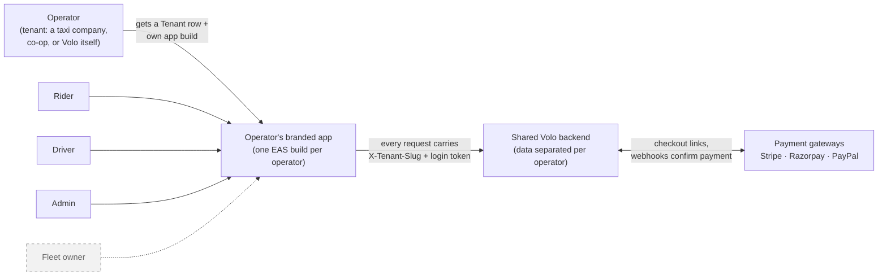
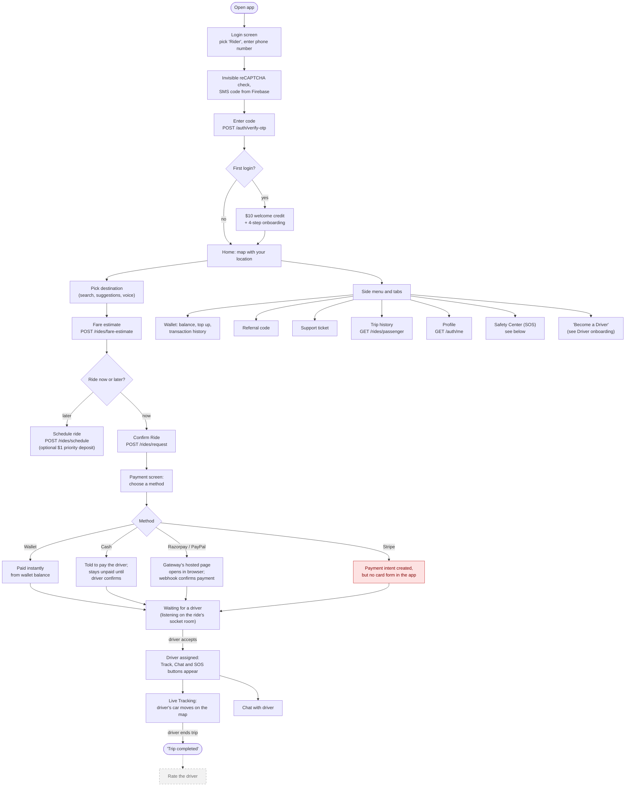
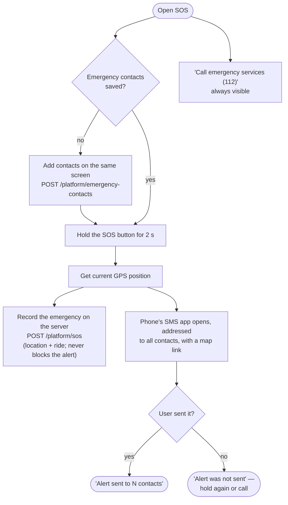
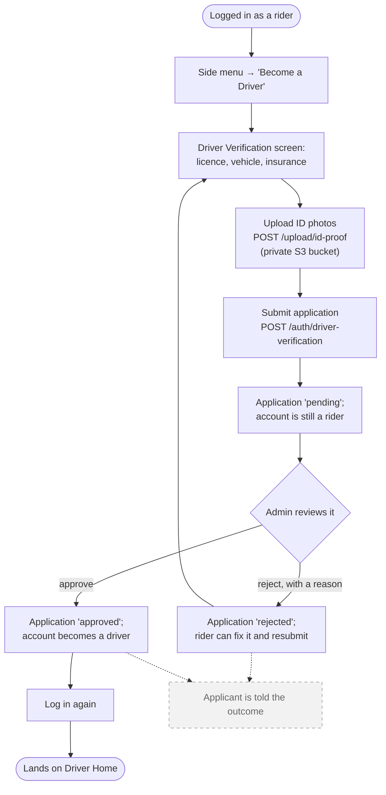
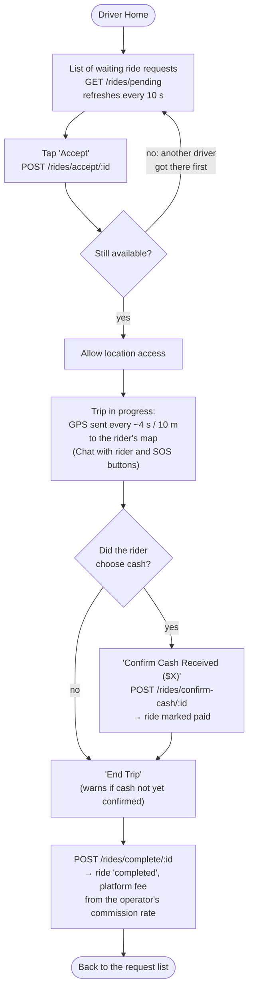
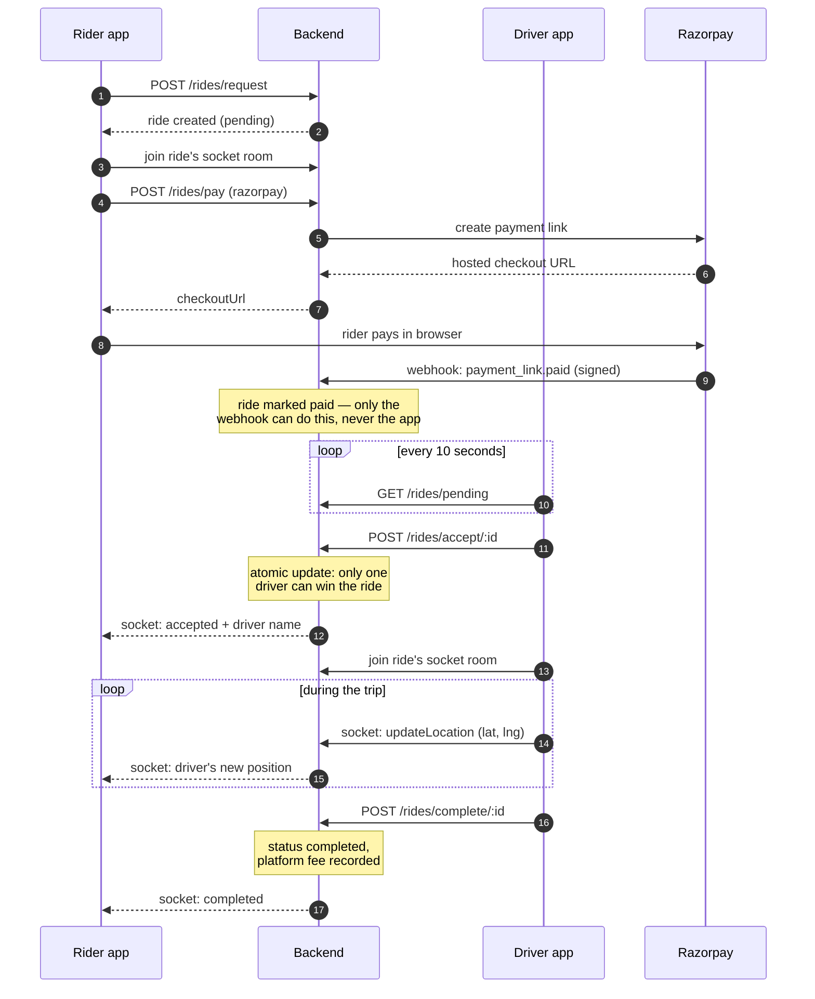
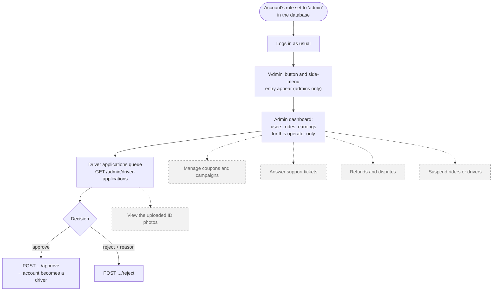
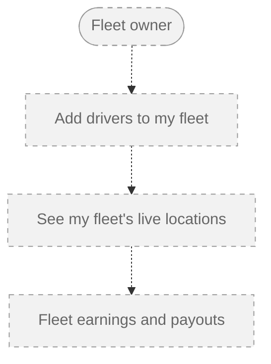
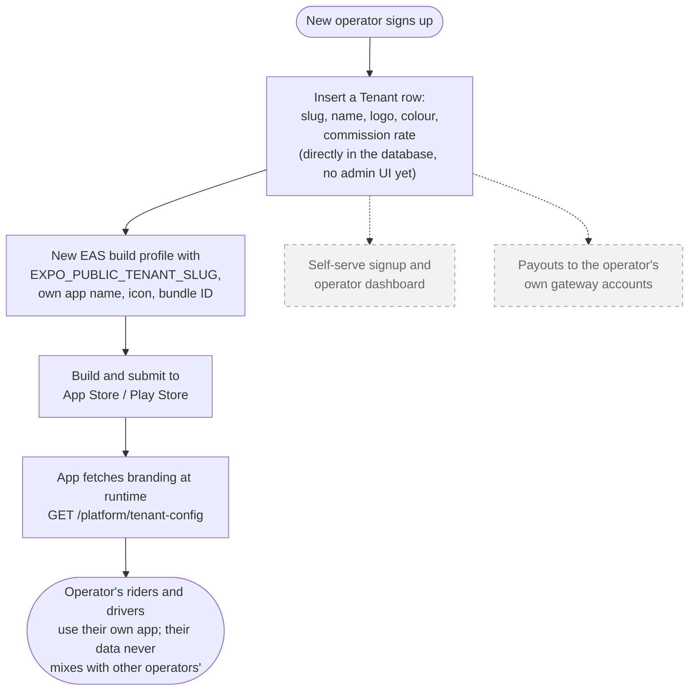

# User Flows

How each kind of user moves through Volo, drawn from what the code actually
does today, not what it is meant to do eventually. Each step is marked:

- **Plain box**: works end to end.
- **Red box**: the screen exists, but the step is broken or incomplete.
- **Grey dashed box**: not built at all.

The diagrams render on GitHub. Locally, use any Markdown viewer with
Mermaid support.

## Who's who

Every rider, driver and admin account belongs to exactly one operator. The
same phone number can have separate accounts with different operators.
Everyone starts as a rider: drivers are riders whose application an admin
approved, and admins are set up directly in the database (see
[Admin](#admin)).

## Rider

**Not working yet:**
- **Stripe (red):** the server creates the payment, but there's no card form in the app, so it can never complete.
- **Rating (grey):** the API exists (`POST /reviews`), but there's no screen for it.

### SOS

Reachable from the side menu, from the home screen once a ride is active,
from the live tracking screen, and from the driver's trip screen.

No SMS provider is configured, so the alert goes out through the phone's own
SMS app. The screen only says the alert was sent when the phone confirms it.

## Driver

### Onboarding: from rider account to driver

**Grey step:** the applicant isn't notified of the decision. They find out by
logging in again (approved) or reopening the form (rejected).

### Taking a trip

If completing the trip fails, the trip stays open with GPS still running so
the driver can retry.

## One ride, start to finish

The same trip seen across the rider's app, the backend, the driver's app and
the payment gateway, using Razorpay as the example.

With **cash** instead of Razorpay, steps 4–9 become: the rider picks cash,
the driver's screen shows "Confirm Cash Received", and the ride is marked paid
only when the driver taps it.

## Admin

Every `/admin` endpoint checks the stored role on each request, not the one
in the login token, so removing someone's admin role takes effect right away.
An admin only sees and acts on their own operator's data.

**Grey steps:** the queue shows how many ID photos an applicant uploaded, but
there's no way to view them yet (the bucket is private, so this needs
short-lived signed links). The other admin tools aren't built.

## Fleet owner

The `fleet_owner` role and a "managed by" link between accounts exist in the
database, but no screen or endpoint uses either yet.

## Operator (onboarding a new white-label tenant)

Full steps are in
[PRODUCTION_DEPLOYMENT.md](PRODUCTION_DEPLOYMENT.md#7-onboarding-a-new-white-label-operator).

## What's still missing

| Area | Problem | Impact |
|---|---|---|
| Stripe | No card form in the app | Stripe can't be used to pay |
| ID review | Admins can't view uploaded ID photos | Approvals rely on the typed licence details only |
| Ratings | API only, no screen | Ratings never get collected |
| Notifications | Applicants aren't told when they're approved or rejected | They have to check by logging in again |
| Admin setup | Admins are created by editing the database | Fine for a handful of operators |
| Admin tools | No coupons, support inbox, refunds or suspensions | Those are handled outside the app |
| Fleet owner | Role exists, nothing built | — |
| Operator tools | Tenants added by hand in the database | Fine for a handful of operators |
